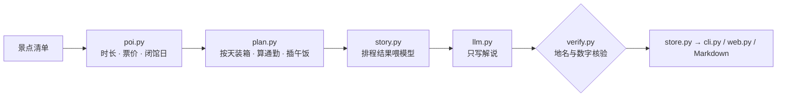

# Xingji · Itinerary Planner

[](https://github.com/wushiyi105-jpg/xingji/actions) []() [](./LICENSE) [](https://codecov.io/gh/wushiyi105-jpg/xingji)

Give it a list of attractions and a few days off, and it lays out an itinerary you can actually walk, then has the model tell it like a person would.

The split is rigid: **scheduling is computed locally, the model never touches a character of it; the model only narrates, and while narrating it may not add places or invent numbers.**


## Why the model does not schedule

I tried. Handed 14 spots, 3 days, 540 minutes per day to the model, and what came back looked like this: day 2 had 4 spots, morning watching pandas in Chenghua, noon eating noodles in Wuhou, afternoon back to Qingyang for a museum, evening off to Wuhou again. Travel time was not counted at all — in its head the map is flat.

Local scheduling has to compute four things, and all four have one right answer:

| What | How | Skip it and |
| --- | --- | --- |
| Daily capacity | per-spot duration + 40 min cross-district travel + 60 min lunch ≤ 540 | the itinerary cannot be walked |
| Closed days | `周一休` in the list filtered by weekday | you show up Monday to a closure notice |
| District clustering | same district back to back, 40 min only across districts | crossing the city back and forth all day |
| Budget | accumulate ticket prices, move on when exceeded | you find out at the ticket window |

The model cannot do any of this, because it does not know 40 minutes is my assumption, nor how long a metro transfer takes. It can do exactly one thing: explain why it is laid out this way.

## One real run

The list is `samples/成都景点.txt`, 14 spots (fictional sample data, durations and prices are rough). 3 days, 540 minutes each, budget 900, day 1 counted as Monday, must-see pandas and Wuhou Shrine.

Out comes 10 spots, 4 left out:

```
第 1 天（周一）· 成华区 / 锦江区 / 青羊区 · 500 分钟 · 105 元
★ 09:00-12:30  大熊猫繁育研究基地  210 分钟  55 元
★ 14:10-15:50  杜甫草堂  100 分钟  50 元
  16:30-17:20  大慈寺  50 分钟  免费

第 2 天（周二）· 武侯区 / 青羊区 · 530 分钟 · 70 元
  09:00-11:00  武侯祠  120 分钟  50 元
  12:40-15:40  四川博物院  180 分钟  免费
  15:40-16:50  人民公园  70 分钟  免费
  16:50-17:50  青羊宫  60 分钟  20 元

第 3 天（周三）· 成华区 / 武侯区 / 青羊区 · 470 分钟 · 70 元
  09:00-11:30  金沙遗址博物馆  150 分钟  70 元
  13:10-14:40  东郊记忆  90 分钟  免费
  15:20-16:50  锦里  90 分钟  免费

没排进去：
  · 春熙路 —— 每天的时间塞满了
  · 太古里 —— 每天的时间塞满了
  · 成都博物馆 —— 每天的时间塞满了
  · 宽窄巷子 —— 每天的时间塞满了
```

The panda base lands at 09:00 as the very first stop because the list says "most active in the morning, the earlier the better". **That was fixed, not luck** — the first version sorted by district and put it at 11:40, by which time the pandas have eaten and gone to sleep. Sorting now looks at three things: must-see, time slot, district.

Sichuan Museum lands on Tuesday because it is "closed Mondays", and day 1 happens to be a Monday.

Then the model narrates:

```
第 1 天 · 熊猫要趁早，下午逛园林
上午先冲大熊猫繁育研究基地，越早到越好，熊猫上午最活跃。下午杜甫草堂园林大，
慢慢走不赶。傍晚大慈寺在闹市里，免费进去转一圈就收工。今天门票一共 105 元。

第 2 天 · 红墙竹影配盖碗茶
武侯祠红墙竹影，建议早去。四川博物院免费但周一闭馆，今天是周二没问题。
人民公园鹤鸣茶社喝盖碗茶歇歇。青羊宫收尾，道观安静。门票合计 70 元。

提醒：
  · 春熙路、太古里、成都博物馆、宽窄巷子这次没排进去，每天时间塞满了，下次再补。
  · 四川博物院周一闭馆，行程安排在周二，别记错日子。
```

Every number lines up: 105 yuan is day 1's ticket total, 70 is day 2's, 210 minutes is the panda base duration. It invented nothing.

## Verification: two real crashes

**The first: four fake place names caught, all my regex's fault.**

Version one grabbed "Chinese fragments ending in a place-name suffix", and the suffix list included single characters like 「馆」「寺」「里」. It reported four:

- `闹市里的寺` — from the note "闹市里的寺院"
- `注意周一闭馆` — "闭馆" contains 「馆」
- `老厂房改的园区` — 「园区」is a suffix, everything before it is a modifier
- `时长都按行程里` — 「里」treated as a place-name suffix

Warnings longer than the text, not one of them real. Three layers of fix: suffixes must be two characters or more (no single-character suffixes at all), candidates may not contain function words like 「的、在、要、去、来」, and **strip the known names out of the text first** before scanning — otherwise "上午去武侯祠" gets sliced through the middle.

**The second: sticking across punctuation.**

Two left after the fix: `墙竹影+博物馆` and `天：金沙遗址`. Both are characters from headings. The cause was not checking character type while expanding backwards, so the regex walked over `+` and `：` and glued the previous sentence's tail on. Requiring "every segment expanded backwards must be entirely Chinese" cleaned it up.

Now: 0.

**Number verification** is a separate system: any number with a unit (yuan, minutes, hours) must fall inside the set of values that actually appears in the itinerary. On the first run "今天门票一共 105 元" was a false positive — 105 is the daily ticket total, and I had only whitelisted individual spot prices, not daily totals. Added, now 0.

Distances (km) are always flagged: the list contains no distance data at all, so any distance the model writes is invented.

## Data flow

How one piece of data moves between the modules:



## Quick start

```bash
git clone https://github.com/wushiyi105-jpg/xingji.git && cd xingji
cp .env.example .env      # fill in LLM_API_KEY

python -m xingji import samples/成都景点.txt --destination 成都
python -m xingji plan --destination 成都 --days 3 --weekday 1 --must 大熊猫繁育研究基地,武侯祠
python -m xingji story 1        # have the model narrate (needs network)
```

`plan` calls no model and works offline; only `story` needs a key.

Start the Web UI:

```bash
python -m xingji serve      # http://127.0.0.1:8776
```

## List format

One spot per line, pipe separated:

```
名称 | 区域 | 建议时长(分钟) | 门票(元) | 开放日 | 最佳时段 | 必去 | 备注
武侯祠 | 武侯区 | 120 | 50 | 全周 | 上午 | 1 | 红墙竹影，建议早去
四川博物院 | 青羊区 | 180 | 免费 | 周一休 | 上午 | 0 | 周一闭馆，别白跑
```

Open days accept these spellings: `全周`、`周一休`、`逢周一闭馆`、`周二至周日`、`周一,周三`、`1,2`.

Time slots accept only `上午`, `下午`, `全天`, used to order spots within a day.

## Commands

| Command | What it does |
| --- | --- |
| `import <文件> [--destination]` | Import a list; the same destination is fully replaced |
| `plan --destination X [--days] [--minutes] [--weekday] [--must] [--budget]` | Schedule, no model |
| `story <id> [--prefs]` | Have the model narrate the itinerary, then verify |
| `list` / `show <id>` / `rm <id>` / `stats` / `serve` | Manage, view, Web UI |

`--weekday` is which weekday day 1 is: Sunday 0, Monday 1 (default). That numbering matches `open_days` in the list; they were out of sync once, which put a Monday-closed museum onto a Monday.

## The Web UI

Fill in the list and parameters on the left, click "排一下" for an instant result (local compute, instant). "写解说" on the right is what actually calls the model. Verification issues appear as yellow bars under the text, not hidden.

## Design trade-offs

- **Zero third-party dependencies**, Python 3.10+, standard library.
- **Spots that do not fit are not hidden.** Better to tell you "Chunxi Road did not make it, the days are full" than to quietly squeeze it in and let you find out on site that you cannot walk it.
- **Travel is a flat 40 minutes.** Reality varies a lot, but one assumption beats none; change it with `--travel`.
- **Lunch is a fixed hour, inserted between two spots**, never inside a visit.
- **Re-importing the same destination replaces the whole list.** A changed list should be a new one, old spots do not linger.
- **Itinerary and narration are stored separately.** Rewriting the narration does not disturb the schedule.

## Limits

- The list is yours to compile; there is no map data, distances are estimated as "same district 0, cross-district 40 minutes".
- Opening hours are not handled (spots that open after 9am or close before 6pm will overflow the day).
- Place-name verification relies on suffixes plus function-word filtering and will miss things — "那家面馆" has no suffix and is not caught. Missing is preferred over false alarms.
- Sorting is greedy, not globally optimal.

## Tests

```bash
python -m unittest discover -s tests
```

117 cases, all offline. The model is a double; the Web layer starts a real server on `port=0`.

Covered: the six open-day spellings and cross-week ranges, closed-day filtering, capacity and cross-district travel, lunch insertion position, budget cut-off, must-see priority, morning before afternoon, lunch not counted twice per day (there was a real double-count bug here), weekday numbering aligned with the list, place-name verification against function words and punctuation gluing, the number whitelist including daily totals, narration JSON truncation retried with a doubled budget, and Web 400/404/502.

## Configuration

`.env` (in `.gitignore`):

```
LLM_API_KEY=...
LLM_BASE_URL=https://open.bigmodel.cn/api/paas/v4
LLM_MODEL=glm-4.6
```

Works with any OpenAI-style `/chat/completions`.

---

Author: shiyi
Email: wushiyi105@gmail.com
GitHub: [wushiyi105-jpg](https://github.com/wushiyi105-jpg)
